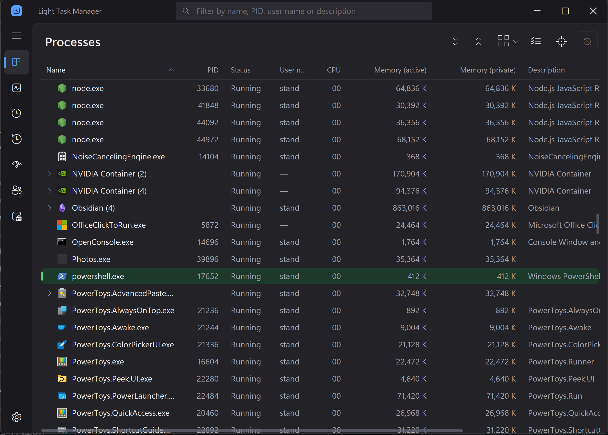
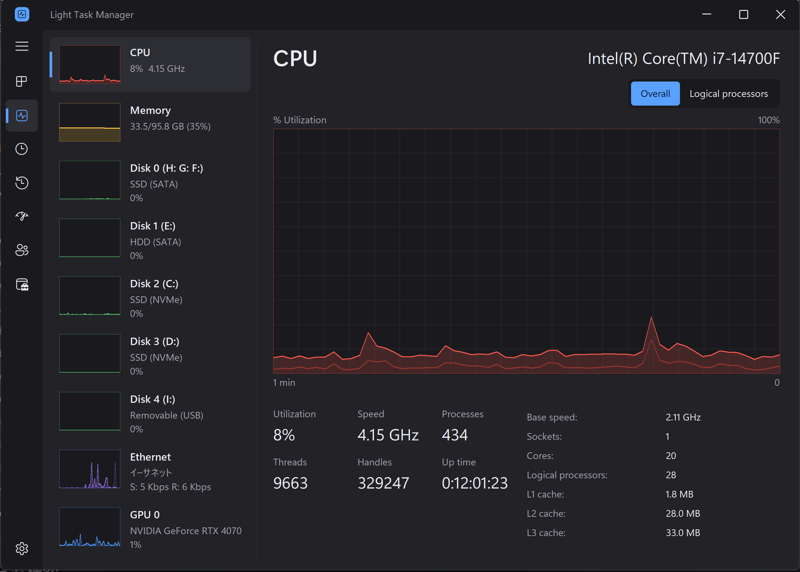
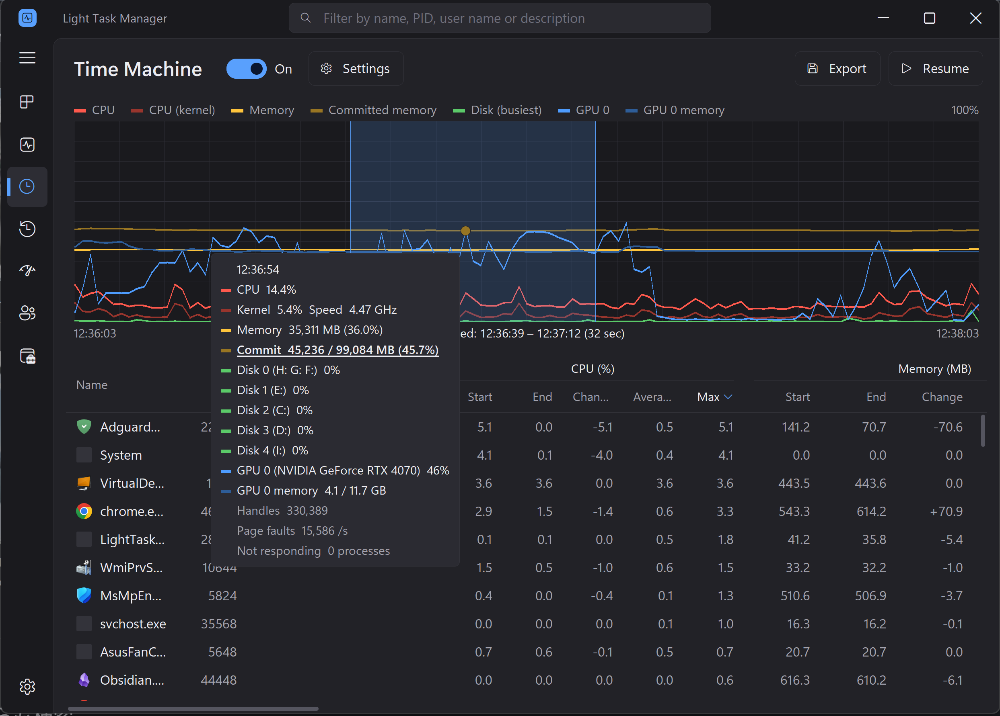
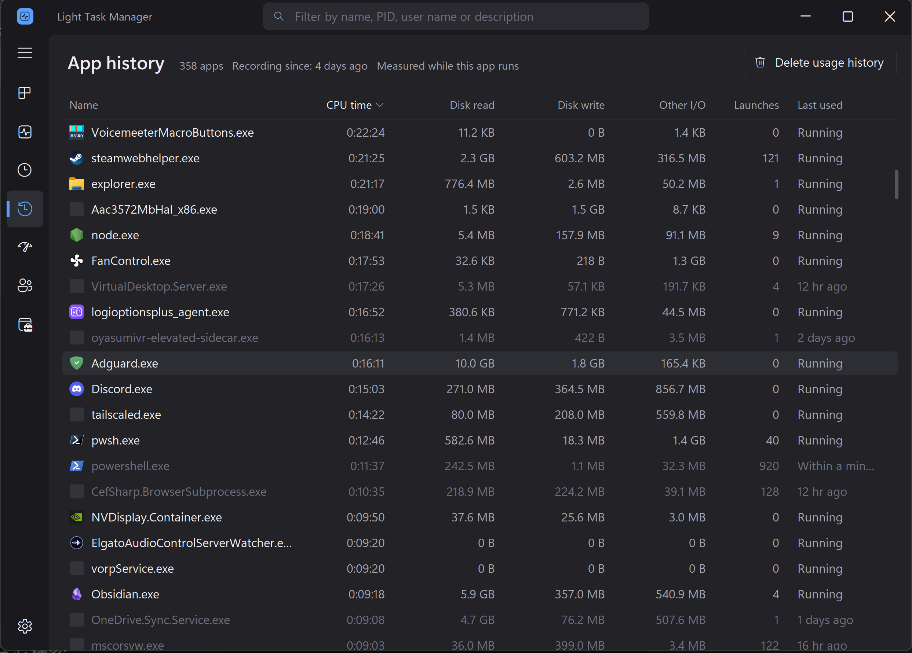
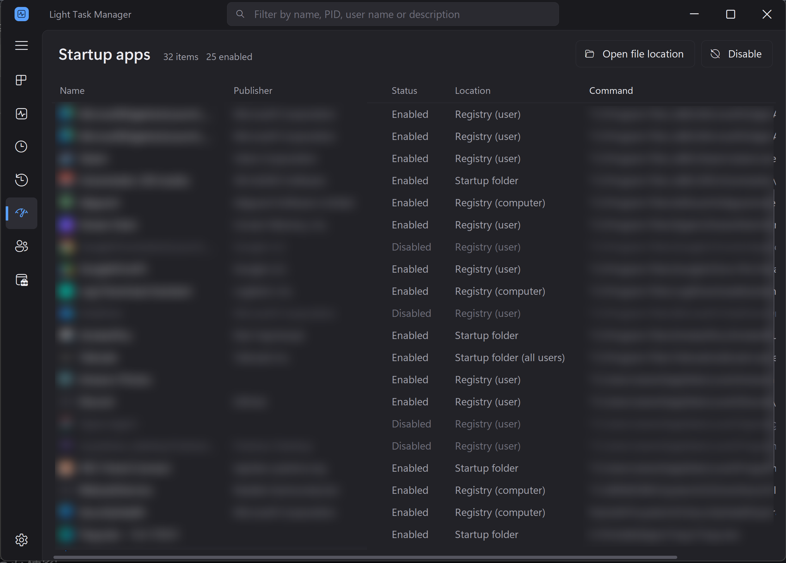
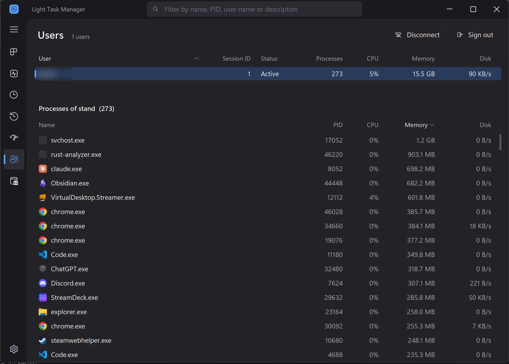
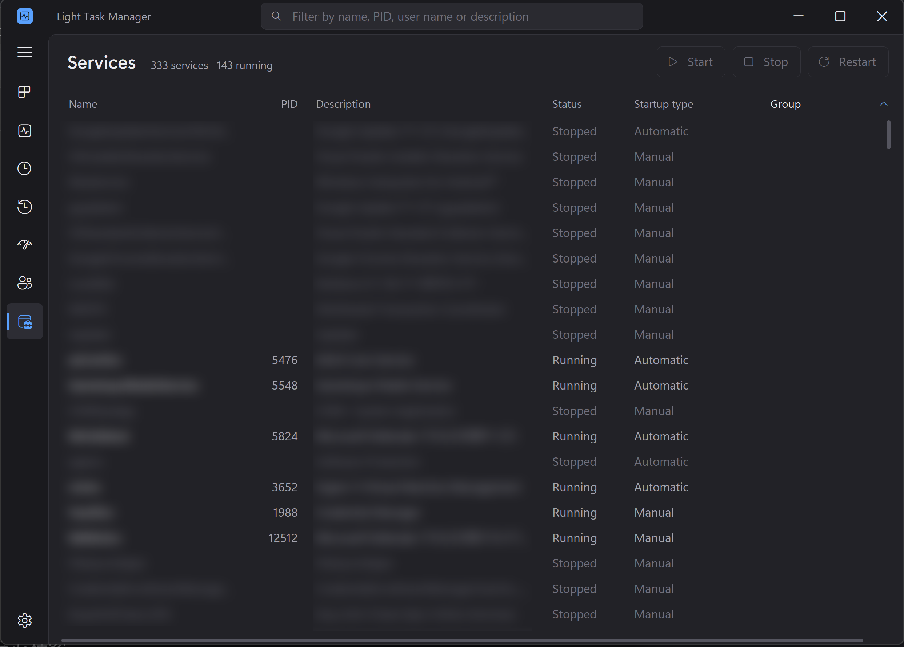

# Light Task Manager

[English](README.md) | 日本語

Windows 11 向けの軽量なタスクマネージャーです。

## ショーケース

**プロセス**



**パフォーマンス**



**タイムマシン**



**アプリの履歴**



**スタートアップ アプリ**



**ユーザー**



**サービス**



## 使い方

### 起動

`LightTaskManager.exe` を実行します（インストール不要）。

- **権限による違い:** 通常権限では多くの情報を表示しますが、管理者として起動すると以下が可能になります。
  - 他のユーザーや管理者プロセスの値表示（通常は「—」）
  - プロセスごとの TCP ネットワーク通信量
- **切り替え:** 設定ページの「管理者として再起動」からいつでも切り替えられます。「起動時に管理者として起動する」をオンにすると、起動時にUAC確認を経て管理者で再起動します（拒否された場合は通常権限で起動）。

### 言語

表示言語は英語、日本語、簡体字中国語、韓国語から選べます。設定ページの「言語」で選ぶと、再起動せずにすぐ切り替わります。既定の「自動」は Windows の表示言語に合わせ、対応していない言語のときは英語になります。

### 基本操作

| 操作 | キー / マウス |
| --- | --- |
| **選択・移動** | 行をクリック / `↑` `↓` `PageUp` `PageDown` `Home` `End` |
| **コンテキストメニュー** | 右クリック |
| **フィルタ（検索）** | タイトルバーの検索欄、`Ctrl+F`、または表にフォーカスして直接入力 |
| **フィルタ解除 / 再読み込み** | `Esc`（検索欄） / `F5` |
| **ソート** | 列見出しをクリック |
| **表示の切り替え** | ツールバーの表示ボタンで、フラット / グループ / ツリーを選ぶ。グループとツリーでは、左の 2 つのボタンですべて展開 / すべて折りたたむ |
| **グループ・ツリーの開閉** | 行頭の `>` をクリック / `←` `→` |
| **ウィンドウからプロセスを探す** | ツールバーの照準ボタンを押してから、画面上のウィンドウをクリック（`Esc` か右クリックで取り消し） |
| **列の幅・順序** | 見出しの境界・見出しをドラッグ |
| **行のコピー** | `Ctrl+C` |
| **タスクの終了** | `Delete`、ツールバーのボタン、または行の右クリック |

### ページ一覧

| ページ | 内容・特記事項 |
| --- | --- |
| **プロセス** | 全プロセスの表（標準のプロセスと詳細を統合）。列ヘッダーの「列の選択」や右クリックから表示列を変更可能。詳しくは「プロセス ページ」の節。 |
| **パフォーマンス** | CPU（全体・論理ごと）、メモリ、ディスク、ネットワーク、GPU のリアルタイムグラフと数値。<br>グラフのため、ほかのページを開いているときや最小化中も、システム全体の値（GPU を含む）を取得し続けます。 |
| **タイムマシン** | 直近の数分間の CPU・メモリ・GPU の使用率と、その時点のプロセスごとの使用量を記録して、あとから見返す。詳しくは「タイムマシン」の節。 |
| **アプリの履歴** | 実行ファイルごとの CPU 時間と I/O の累計。<br>`%APPDATA%\LightTaskManager\history.tsv` に保存。 |
| **スタートアップ アプリ** | Run キーとスタートアップ フォルダーの項目。有効 / 無効の切り替え。 |
| **ユーザー** | サインイン中のセッションと使用量、選択ユーザーのプロセス。切断 / サインアウト操作が可能。 |
| **サービス** | サービスの一覧と開始 / 停止 / 再起動。 |
| **設定** | 言語、更新速度、管理者起動の切り替え、コピー書式のカスタマイズ、プロセスの生成と破棄の強調表示のオンオフ。 |

## 仕様

### プロセス ページ

- **表示の切り替え**: フラット（プロセスを 1 行ずつ）、グループ（タスク マネージャーと同じまとめ方）、ツリー（親子関係）を選べます。選んだ表示は保存されます。
  - ツリーは親 PID と作成時刻で親子をつなぎます。親が子より新しいときは PID が再利用されたものとみなし、親にしません。親がもう存在しないプロセスは一番上の階層に出ます。
  - ツリーの並べ替えは兄弟どうしの中だけです。最初はすべて閉じた状態で、開閉の状態は保存しません。
  - ツリーでフィルターすると、一致したプロセスとその祖先を表示します（祖先は薄い色）。
- **生成と破棄の強調表示**: 起動したばかりのプロセスは緑、終了したプロセスは赤で、5 秒間と 2 回の更新の長いほうのあいだ表示します。終了したプロセスの行は、最後の値のまま、消えたときの位置に残ります（選んでいればそのまま選んだ状態ですが、終了などの操作はできません）。
  - 起動して最初の一覧は強調しません。ほかのページを見ている間の生成・破棄も記録し、時間が残っていればプロセス ページで見えます。
  - 更新の間隔より短い間に起動して終了したプロセスは、一覧に一度も載らないため表示されません。
  - 畳まれたグループやツリーの中のプロセスが終了したときは、赤い行は出ません。
- **ウィンドウからプロセスを探す（照準）**: 照準ボタンを押すと、画面全体が照準モードになり、カーソルの下のウィンドウを枠で囲んで「名前 (PID)」を出します。クリックすると、そのウィンドウのプロセスを選んでスクロールします。
  - UWP アプリは、枠の `ApplicationFrameHost.exe` ではなくアプリ本体のプロセスを選びます。デスクトップやタスクバーは explorer になります。
  - フィルターで隠れていればフィルターを外し、畳まれたグループやツリーは開きます。起動した直後でまだ一覧にないときは、その旨を知らせます。

### 主な列の仕様

- **既定:** 名前、PID、状態、ユーザー名、CPU、メモリ、WS の差分、アーキテクチャ、説明など
- **プロセスの性質:** パッケージ名、種類、発行元（版情報の会社名）、プラットフォーム
- **保護:** UAC 仮想化、DEP、DPI 対応、電源調整、CFG、スタック保護
  - 電源調整は、列を表示していてプロセス ページを開いている間だけ、更新のたびに読み直します。それ以外は、プロセスを見つけたときの値のままです。
- **入出力 / GPU / ネットワーク:** ディスク速度、GPU 使用率・専用/共有メモリ（GPU 列を表示していてプロセス ページを開いている間だけ取得）、TCP 通信量（管理者起動時のみ）
- **ディスクの割合:** 分母は、起動後に観測した全ディスク合計速度の最大値です（起動後に増えるだけ）。Windows のタスク マネージャーの定義とは一致しません。

### データのコピー (`Ctrl+C`)

選択した行の内容をクリップボードにテキスト形式でコピーします（1項目1行）。コピーの書式や範囲（表示列のみ / 全て）は設定ページから変更できます。

- **不明な値:** 権限不足などで取得できない項目は `-` と出力されます。
- **全列コピー時の注意:** 非表示の列を含めて「全て」を指定した場合、GPUやネットワークなど取得に列の表示が必要な項目は `-` になります。

### タイムマシン

直近の一定期間（保持期間）のサンプルを、更新の速度と同じ間隔で記録します。「さっき一瞬重かったのは何か」をあとから調べるためのページです。

| 操作 | 内容 |
| --- | --- |
| **時点を選ぶ** | グラフをクリックすると、その時点のプロセスを表に出します。 |
| **範囲を選ぶ** | グラフをドラッグすると、その間に存在したプロセスを表に出します。 |
| **ズーム** | グラフの上で `Ctrl` を押しながらホイールを下に回すと拡大、上に回すと縮小します。 |
| **横スクロール** | 拡大している間だけ、グラフの上でホイールを回すと前後に動きます。 |
| **ライブに戻る** | ツールバーの「再開」、または `Esc`。 |
| **表の横スクロール** | 列が収まらないときは、表の下のスクロールバー、`Shift` + ホイール、または横ドラッグ（タッチ）。 |

- **一時停止:** 時点を選ぶか拡大すると、その時点の記録全体を固定して表示します。固定している間も、裏では記録を続けます。
- **範囲の表:** 対象項目ごとに、開始・終了・差分・平均・最大を出します。範囲の途中で生まれたり消えたりしたプロセスは、その時点を開始・終了とし、平均と最大は存在した期間だけで計算します。
  - `+-` 列は、範囲内で生まれたもの（`+`、青）と消えたもの（`-`、赤）です。
  - 「時刻」列は、生まれた時刻（プロセスの作成時刻）と消えた時刻です。消えた時刻は、見えなくなった最初のサンプルの時刻なので、更新の間隔に依存します。
- **設定:** ツールバーの「設定」で、対象項目と保持期間を変えられます。メモリの使用量の見積もりも表示します。
- **対象項目:** 既定は CPU とメモリです。値は対象項目にかかわらず記録するので、あとからオンにしても過去の分を見られます（GPU と GPU メモリは、どちらかがオンの間だけ記録します）。

  | 対象項目 | グラフ（0〜100%） | 表（プロセスごと） |
  | --- | --- | --- |
  | CPU | 使用率 | 使用率 (%) |
  | CPU の内訳 | カーネル時間の割合（ツールチップに速度も） | — |
  | メモリ | 使用率 | アクティブなプライベート ワーキング セット (MB) |
  | コミット済みメモリ | コミット済み / 上限 | プライベート バイト (MB)。リークの調査向き |
  | ディスク | 最も忙しいディスクのアクティブな時間（ツールチップに各ディスク） | 読み書きの速度 (MB/秒) |
  | GPU | GPU ごとの使用率 | 使用率 (%) |
  | GPU メモリ | GPU ごとの専用メモリの使用量 / 総量 | 専用 GPU メモリ (MB) |
  | ハンドル | 線はなし（ツールチップに合計） | ハンドル数 |
  | ページ フォールト | 線はなし（ツールチップに合計） | 1 秒あたりの回数 |
  | 応答なし | 線はなし（ツールチップに数） | 時点では状態、範囲では応答なしだった秒数 |

- **GPU の番号:** パフォーマンス ページと同じ番号です。色は 3 つ目まで別々で、4 つ目以降は同じ色になります。保持期間内に値がない GPU は表示しません。
- **エクスポート:** 時刻か範囲を選んでいる間、ツールバーの「エクスポート」で、選んだ範囲をファイルに出力できます。
  - 出力範囲: 選択期間（時点を選んでいるときは選択時点）か全期間（一時停止したときの記録全体）。全期間の表値は、全期間を範囲とした集計を、最初の対象項目の最大の降順で出します。
  - 出力内容: 表値（今の表そのまま、1 行が 1 プロセス）、プロセス値（各サンプルのプロセスごとの値）、システム値（各サンプルのシステム全体の値）。表値とプロセス値には検索欄のフィルターが効きます。
  - 形式は CSV / TSV、エンコーディングは UTF-8 with BOM / Shift_JIS（表せない文字は `?` になります）。ダイアログに見積ファイルサイズを表示します。
  - 見出しは英語のスネークケースで、単位を末尾に付けます（`_bytes`、`_ratio`（0〜1）、`_seconds`、`_per_second`、`_hz`）。時刻は時差付きの ISO 8601 です。
  - 実行ファイルのパス、コマンドライン、ユーザー名は出力しません。オンの対象項目だけを出力します。
  - 推奨ファイル名は `performance-{年月日}-{時分秒}-{table|process|system}.{csv|tsv}` で、日時は範囲の開始時刻です。
- **起動直後:** 起動してから約 2 秒間の値は記録しません。このアプリ自身の起動の負荷（実行ファイルのアイコンや説明の読み込み）がほとんどを占めるためです。
- **負荷:** オンの間は、ウィンドウを最小化していてもプロセスごとの値の取得を続けます（オフなら、最小化中はシステム全体の値だけを取得します）。GPU を対象にすると、プロセスごとの GPU のカウンターも読み続けます。負荷を減らしたいときは、ツールバーのスイッチでオフにします。オフにすると、記録は破棄されます。

### 設定の保存先

ウィンドウサイズ、列構成、ソート順、更新速度、コピー設定、タイムマシンの設定、言語などは以下のファイルに自動保存されます。

`%APPDATA%\LightTaskManager\settings.ini`

## 開発

### ビルド

`rust-toolchain.toml` が MSVC ツールチェーンを指定しています。ビルドには Visual Studio Build Tools（C++ のビルド ツール）が必要です。導入には管理者権限が必要です。

```bash
winget install --id Microsoft.VisualStudio.2022.BuildTools --override "--passive --add Microsoft.VisualStudio.Workload.VCTools --includeRecommended"
```

`.cargo/config.toml` で C ランタイムを静的にリンクしているため、作られた EXE は VC++ 再頒布パッケージを必要としません。

```bash
cargo build
# or
cargo build --release
```

```bash
cargo test
```

### 構成

| パス | 役割 |
| --- | --- |
| `src/main.rs` | エントリーポイント（通常起動と開発用の `--bench` / `--shot` の振り分け） |
| `src/settings.rs` | 設定の読み込みと保存 |
| `src/devtools.rs` | 開発用のベンチマークとヘッドレスのスクリーンショット |
| **`src/app/`** | **アプリの外枠** |
| `src/app/window.rs` | Win32 メッセージの処理 |
| `src/app/core.rs` | タイトルバー、サイドバー、ページの切り替え |
| `src/app/aim.rs` | 照準モード（画面全体を覆う透明なウィンドウでクリックを受け、その下のウィンドウのプロセスを求める） |
| `src/app/pointer.rs` | タッチとスタイラスのジェスチャ判定 |
| **`src/i18n/`** | **表示言語** |
| `src/i18n/mod.rs` | 言語の一覧、今の言語（`tr()`）、言語ごとのフォント |
| `src/i18n/strings.rs` | UI の文字列の型（ページごとにまとめる） |
| `src/i18n/en.rs` など | 言語ごとに 1 ファイル。すべての文字列を埋める |
| **`src/system/`** | **システムの情報の取得と操作** |
| `src/system/sampler.rs` | バックグラウンドのプロセス情報取得（プロセスの列、GPU・ネットワークの通信量、マニフェストの読み込み） |
| `src/system/sysinfo.rs` | CPU・メモリ・ディスク・ネットワーク・GPU の取得（パフォーマンスページ用）と、プロセスごとの GPU・TCP 通信量 |
| `src/system/model.rs` | プロセスやイメージの情報の型 |
| `src/system/demand.rs` | サンプラーが取得するものの需要。各ページが `Page::demand` で「表示中だけ」と「常に」の需要を申告し、その和だけを取得する |
| `src/system/actions.rs` | プロセスやシェルへの操作（終了、場所を開くなど） |
| `src/system/win.rs` | Win32 呼び出しまわりの小さな変換（UTF-16 文字列、FILETIME、COLORREF） |
| **`src/ui/`** | **描画とページ共通の部品** |
| `src/ui/gfx.rs` | CPU 描画（DIB への塗りと GDI の文字描画） |
| `src/ui/theme.rs` | 配色 |
| `src/ui/icons.rs` | アイコン フォントの文字 |
| `src/ui/keys.rs` | ページが扱う仮想キー コード |
| `src/ui/widgets.rs` | 一覧ページ共通の表、メニュー、確認ダイアログ、ツールバー |
| `src/ui/copyfmt.rs` | 行のコピー書式 |
| **`src/pages/`** | **各ページ**（`mod.rs` に `Page` トレイト） |
| `src/pages/details/` | プロセス ページ。`rows.rs`（グループ・ツリー・並べ替え・フィルター）、`input.rs`（入力とメニュー）、`paint.rs`（描画）、`columns.rs`（列の定義、整形、比較）、`grouping.rs`（プロセスのグループ化） |
| `src/pages/timemachine/` | タイムマシン。`target.rs`（対象項目）、`table.rs`（表）、`input.rs`（入力）、`paint.rs`（描画）、`export.rs`（エクスポート） |

### ページの追加

1. `src/pages/` に `Page` トレイトを実装したファイルを作ります。
2. `src/pages/mod.rs` の `all()` に 1 行追加します。サイドバーの項目は `Page::nav()` から自動で作られます。
3. サンプラーに取得してほしいものがあるページは、`Page::demand` で申告します。表示中だけ要るものは `shown`、最小化中も含めて常に要るものは `always` に入れます。

### 列の追加

1. `src/pages/details/columns.rs` の `Col` に列挙子を追加し、`ALL` の末尾に定義を追加します（`ALL` の長さも更新します）。
2. 値の取得元（`src/system/sampler.rs` など）と、`number` / `text` / `cell` の分岐を追加します。
3. 取得に追加の処理が必要な列は、必要なときだけ取得します。`src/system/demand.rs` の `need` に項目を足し、`columns::demand` で列から需要を作り、`src/system/sampler.rs` でその項目があるときだけ取得します。
4. コピーに出す技術的な名前は `columns::prop` に追加します。一覧ページの列は `col(見出し, プロパティ名, 幅, 右寄せ)` の形で書きます。

見出しはコードに直接書かず、`src/i18n` から引きます（「文字列の追加」の節）。

### コピー書式の追加

`src/ui/copyfmt.rs` の `Format`（書式）と `Scope`（範囲）に、次の 4 か所を追加します。

1. 列挙子
2. `ALL` への追加
3. `key`（設定ファイルの名前）と `label`（設定ページの表示名）
4. `Format::line` の分岐（書式の場合）

設定ファイルの読み込みは `from_key` を使い、知らない名前は既定の値になります。設定ページの選択肢は `ALL` から作られるため、画面を直す必要はありません。

### 文字列の追加

UI に出す文字列はコードに書かず、`src/i18n` に置きます。コードからは `tr()` で引きます（例: `tr().common.cancel`）。

1. `src/i18n/strings.rs` の該当する構造体に項目を足します。値が入る文は `fn(&str, usize) -> String` のような関数にして、言語ごとに語順を変えられるようにします。
2. すべての言語ファイル（`en.rs`、`ja.rs`、`zh_hans.rs`、`ko.rs`）に訳を書きます。訳し漏れがあるとコンパイルできません。
3. 一度作って持ち続ける表（列見出しなど）のラベルは、`&str` ではなく `Text`（`|s| s.common.name`）にします。こうすると言語を切り替えたときに追従します。

### 言語の追加

1. `src/i18n/en.rs` を新しいファイルにコピーして訳します。
2. `src/i18n/mod.rs` の `Lang` に列挙子を足し、各分岐を埋めます。設定ファイルでのキー、その言語自身での名前、文字列、フォント、`from_langid` でその言語を選ぶ Windows の表示言語です。

設定ページの言語の選択肢は `Lang::ALL` から作られるため、画面を直す必要はありません。

### 開発用コマンド

```bash
./target/release/LightTaskManager.exe --bench bench.txt
```

```bash
./target/release/LightTaskManager.exe --shot shot.bmp 1 8
```

`--bench` は 5,000 行での描画、スクロール、フィルタ、ソートの時間を計測します。
`--shot` はウィンドウを開かずに指定ページ（0 始まり）を BMP に書き出します。ページの後に `expand` を付けると、グループ（ツリー）をすべて展開します。`view=flat|group|tree` でプロセス ページの表示を選びます。`lifetime` を付けると、先頭近くの 2 つのプロセスが終了し 1 つが起動した更新をもう 1 回渡します（生成と破棄の強調表示の確認用）。`lang=en|ja|zh-Hans|ko` で言語を選びます（省略するとアプリと同じく Windows に合わせます）。
ページの後に数値を付けると、その回数だけ追加で計測してから書き出します（パフォーマンスページやタイムマシンのグラフ確認用）。
`size=幅,高さ` でウィンドウの大きさを指定します（既定は 1240,760）。`tm_gpu` を付けるとタイムマシンで GPU を記録し（`tm=cpu,disk,...` で対象項目を直接指定もできます）、`tm_off` を付けるとタイムマシンをオフにします。`from_start` を付けると、最初のサンプルからページに渡します（起動直後の確認用）。`verbose` を付けると、サンプルごとの中身を出します。`minimized` を付けると、最小化した状態として計測し、`restore` を付けると、そのあと元に戻した直後のサンプルも取ります。届いたサンプル数、最後のサンプルの中身、取得している需要を標準出力に出します。
`click=x,y`、`drag=x1,y1,x2,y2`、`move=x,y`、`zoom=x,y,ノッチ数`（`Ctrl` + ホイール）、`wheel=x,y,dx,dy`、`key=仮想キーコード`、`type=文字列`、`filter=検索語` を付けると、書き出す前にその操作を再現します。
`--shot` は既定の列で書き出すため、列の設定は反映されません。
