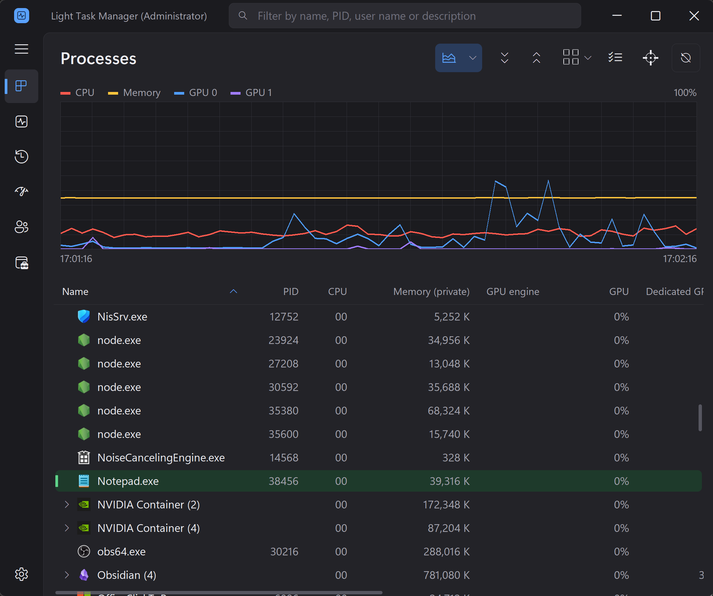
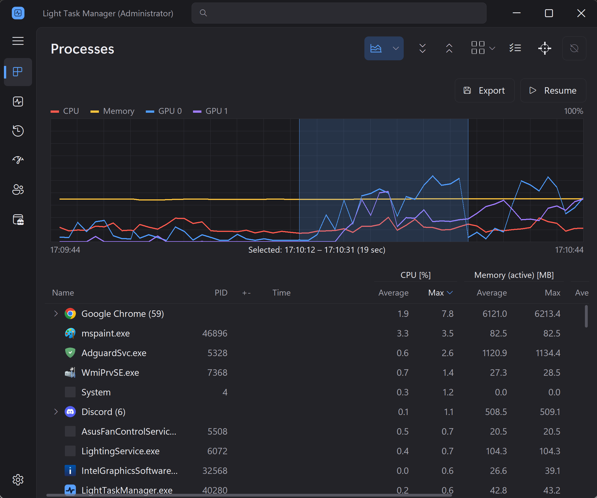
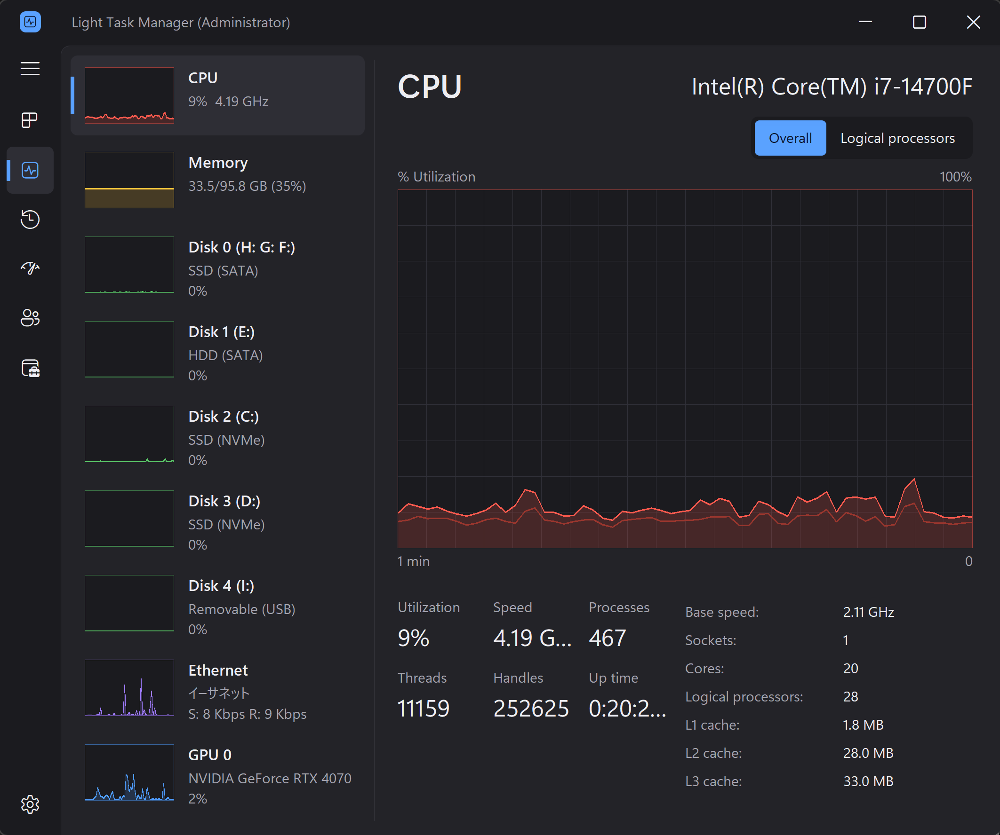
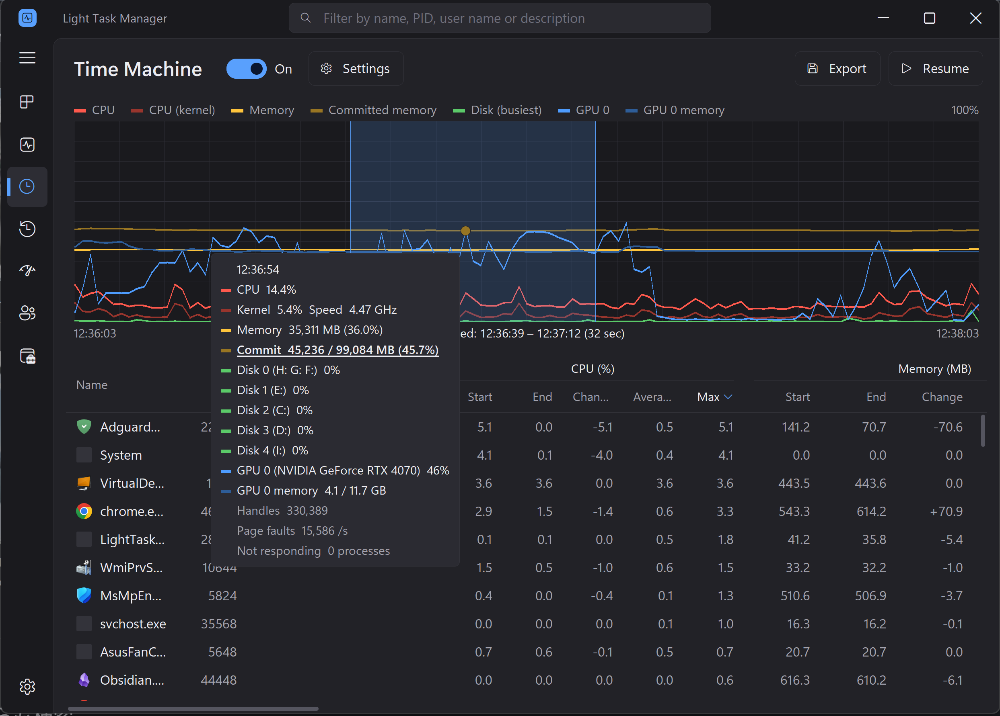
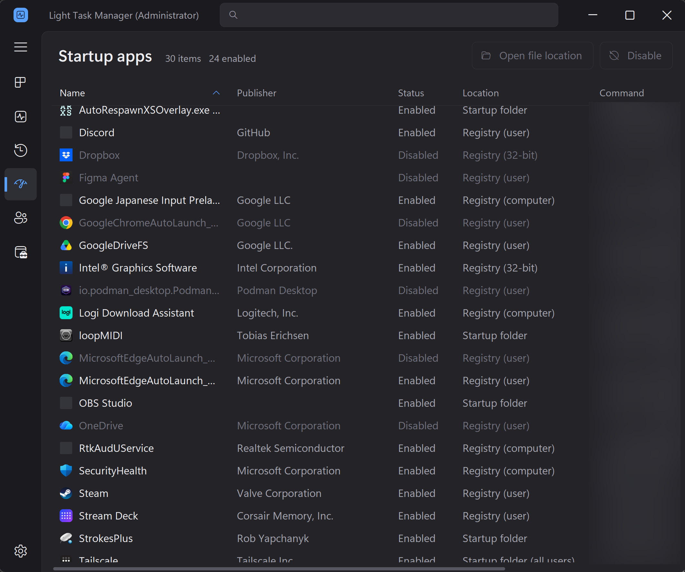
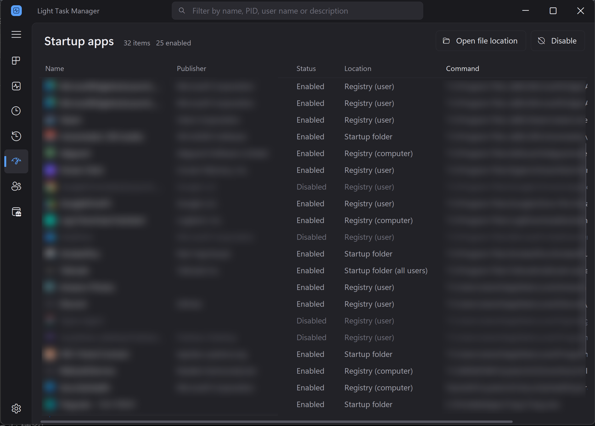
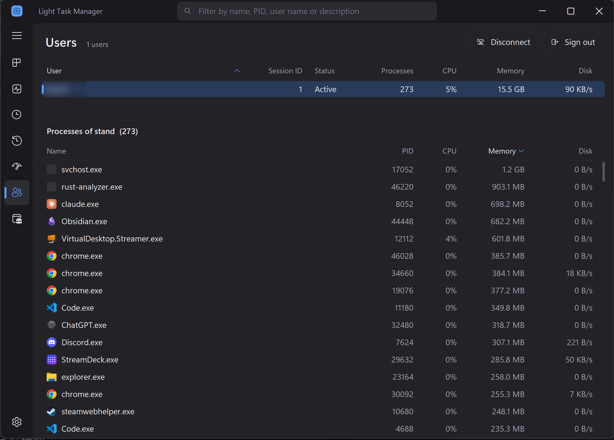

# Light Task Manager

English | [日本語](README.ja.md)

A lightweight task manager for Windows 11.

## Showcase

**Processes**





**Performance**



**App history**



**Startup apps**



**Users**



**Services**



## Usage

### Starting

Run `LightTaskManager.exe` (no installation needed).

- **Privileges:** Most information is shown with normal privileges. Running as administrator adds:
  - Values of other users' and elevated processes (otherwise shown as "—")
  - TCP network traffic per process
- **Switching:** Use "Restart as administrator" on the Settings page at any time. With "Start as administrator" on, the app restarts as administrator through the UAC prompt when it starts (if the prompt is declined, it runs with normal privileges).

### Language

The UI is available in English, Japanese, Simplified Chinese and Korean. Choose one under "Language" on the Settings page; the change applies right away, without a restart. "Auto" (the default) follows the Windows display language, and falls back to English when that language is not supported.

### Basic controls

| Action | Key / mouse |
| --- | --- |
| **Select / move** | Click a row / `↑` `↓` `PageUp` `PageDown` `Home` `End` |
| **Context menu** | Right-click |
| **Filter (search)** | The search box in the title bar, `Ctrl+F`, or just type while the table has focus |
| **Clear filter / refresh** | `Esc` (in the search box) / `F5` |
| **Sort** | Click a column header |
| **Change view** | Pick Flat / Grouped / Tree with the view button on the toolbar. In Grouped and Tree, the two buttons to its left expand all / collapse all |
| **Expand / collapse a group or tree** | Click the `>` at the start of the row / `←` `→` |
| **Find a process by its window** | Press the crosshair button on the toolbar, then click a window on the screen (`Esc` or right-click cancels) |
| **Column width / order** | Drag a header border / a header |
| **Copy a row** | `Ctrl+C` |
| **End task** | `Delete`, the toolbar button, or right-click a row |

### Pages

| Page | Contents and notes |
| --- | --- |
| **Processes** | A table of all processes (the standard Processes and Details tabs in one). Change the columns with "Select columns" on the toolbar or by right-clicking a header. See "Processes page" below.<br>The graph at the top records the last few minutes; click it to list the processes at that time, or drag to sum up a range. See "The graph" below. |
| **Performance** | Live graphs and figures for CPU (overall and per logical processor), memory, disks, network and GPUs.<br>For the graphs, system-wide values (GPUs included) keep being read while other pages are open or the window is minimized. |
| **App history** | Total CPU time and I/O per executable.<br>Saved in `%APPDATA%\LightTaskManager\history.tsv`. |
| **Startup apps** | Entries of the Run keys and the Startup folders. Enable or disable them. |
| **Users** | Signed-in sessions with their resource use, and the processes of the selected user. Disconnect or sign out. |
| **Services** | The list of services; start, stop or restart them. |
| **Settings** | Language, update speed, running as administrator, copy format, and highlighting of process start and end. |

## Details

### Processes page

- **Views**: Flat (one row per process), Grouped (grouped as in Task Manager) or Tree (parent and child). The chosen view is saved.
  - The tree links parents and children by parent PID and creation time. A parent newer than its child is taken as a reused PID and not made the parent. Processes whose parent no longer exists are at the top level.
  - Sorting in the tree is only among siblings. Everything starts collapsed, and what is expanded is not saved.
  - Filtering in the tree shows the matching processes and their ancestors (ancestors are dimmed).
- **Highlighting start and end**: Processes that just started are shown in green and ended ones in red, for 5 seconds or 2 updates, whichever is longer. An ended process's row stays where it was, with its last values (it stays selected if it was, but cannot be acted on).
  - The first list after the app starts is not highlighted. Starts and ends are also recorded while other pages are open, and show on the Processes page if time remains.
  - Processes that start and end within one update interval never make it into the list, so they are not shown.
  - When a process inside a collapsed group or tree ends, no red row is shown.
- **Find a process by its window (crosshair)**: Pressing the crosshair button puts the whole screen in aiming mode, outlining the window under the cursor and showing "name (PID)". Clicking selects that window's process and scrolls to it.
  - For UWP apps, the app's own process is chosen rather than the `ApplicationFrameHost.exe` frame. The desktop and taskbar give explorer.
  - A filter that hides the process is cleared, and collapsed groups or trees are expanded. A process that just started and is not in the list yet is reported as such.

### Main columns

- **Default:** Name, PID, Status, User name, CPU, memory, WS delta, Architecture, Description and more
- **What a process is:** Package name, Type, Publisher (the company name in the version info), Platform
- **Protection:** UAC virtualization, DEP, DPI awareness, Power throttling, CFG, Stack protection
  - Power throttling is read again on every update only while its column is shown and the Processes page is open. Otherwise it keeps the value read when the process was found.
- **I/O / GPU / network:** Disk rate, GPU usage and dedicated/shared memory (read only while a GPU column is shown and the Processes page is open), TCP traffic (only when running as administrator)
- **Disk percentage:** The 100% mark is the highest total rate of all disks seen since the app started (it only grows). This differs from Windows Task Manager's definition.

### Copying data (`Ctrl+C`)

Copies the selected row to the clipboard as text (one item per line). The copy format and scope (shown columns only / all) can be changed on the Settings page.

- **Unknown values:** Items that cannot be read, for example for lack of privileges, are written as `-`.
- **Copying all columns:** With "All", items that need their column to be shown to be read, such as GPU and network, are `-` while hidden.

### The graph (past moments and ranges)

The graph at the top of the Processes page records samples over a recent period (the retention period, 1 minute by default) in memory, at the same interval as the update speed. It is for finding out afterwards what made the PC slow a moment ago.

| Action | What it does |
| --- | --- |
| **On / off** | The graph button on the toolbar. Turning it off discards the record, after asking (choose "Don't ask me again" to skip the question from then on). |
| **Settings** | Right-click the graph, or use the ∨ of the graph button, and choose "Graph settings". Change the items and the retention period. |
| **Height** | Drag the border between the graph and the table. The height is saved. |
| **Pick a time** | Click the graph: the table lists the processes at that time, with the same columns, view (flat / groups / tree), sorting and filter as usual. |
| **Pick a range** | Drag on the graph: the table sums up that range (the range table). |
| **Zoom** | Over the graph, hold `Ctrl` and scroll down to zoom in, up to zoom out. |
| **Scroll sideways** | Only while zoomed in, scroll over the graph to move back and forth. |
| **Back to live** | "Resume" under the toolbar, or `Esc`. |

- **Pause:** Picking a time or zooming in freezes the whole record at that moment. Recording goes on in the background while frozen. Export and Resume appear under the toolbar.
- **Acting on the past:** Only processes still running with the same PID and creation time can be ended.
- **Range table:** Its columns are items × statistics. Items (CPU, memory, I/O and so on) and statistics (start, end, change, average, minimum, maximum) are chosen separately in "Select columns": turning "Max" off drops the maximum of every item. Right-click a column header to hide its item, or its statistic for every item.
  - CPU time, I/O bytes and counts, page faults and cycles only grow, so they have one column: how much they grew within the range ("In range").
  - For processes that started or ended within the range, those times are the start or end, and the average, minimum and maximum cover only the time they existed.
  - In the groups view, a group's row sums its members at each sample before summing up: a group's maximum is the heaviest moment of the whole group.
  - The `+-` column marks processes that started (`+`, green) or ended (`-`, red) within the range.
  - The "Time" column shows when they started (the process creation time) or ended. The end time is that of the first sample without the process, so it depends on the update interval.
  - System Idle Process (the processors' free time) is left out.
- **Items:** The lines of the graph. CPU and memory by default. Values are recorded whatever the items are, so turning one on later still shows the past (GPU and GPU memory are recorded only while either is on).

  | Item | Graph (0–100%) |
  | --- | --- |
  | CPU | Utilization |
  | CPU breakdown | Share of kernel time (the tooltip also shows the speed) |
  | Memory | Utilization |
  | Committed memory | Committed / limit |
  | Disk | Active time of the busiest disk (the tooltip shows each disk) |
  | GPU | Utilization per GPU |
  | GPU memory | Dedicated memory used / total per GPU |

- **What is recorded:** The values of every column of the table. GPU, network, power throttling and user / GDI objects are read only while their column (or, for the range table, their item) is shown, so they are 0 while it was not.
- **Memory:** What never changes about a process is kept once per process, and the values are packed into small integers (about 140 bytes per process and sample): 300 processes every second take about 2.5 MB a minute. The settings dialog shows the memory in use now and an estimate for the retention period.
- **GPU numbers:** The same numbers as on the Performance page. The first three GPUs have their own colors; the fourth and later share one. GPUs with no values in the retention period are not shown.
- **Export:** While a time or range is picked, "Export" under the toolbar writes the selection to a file.
  - Range: the selection (or the selected time) or everything (the whole record at the time it was frozen). The table for everything is summed over the whole record, in the order the range table is sorted.
  - Content: Table (the table as shown, one row per process, the shown columns), Per process (each process's values in every sample) or System (system-wide values in every sample). The search filter applies to Table and Per process.
  - Format CSV / TSV; encoding UTF-8 with BOM / Shift_JIS (characters it cannot represent become `?`). The dialog shows an estimated file size.
  - Headers are English snake_case with the unit at the end (`_bytes`, `_ratio` (0–1), `_seconds`, `_per_second`, `_hz`). Times are ISO 8601 with the UTC offset.
  - Executable paths, command lines and user names are not written.
  - The suggested file name is `performance-{date}-{time}-{table|process|system}.{csv|tsv}`, with the start of the range as the date and time.
- **Right after starting:** Values from about the first 2 seconds are not recorded, since they are mostly the load of this app starting up (reading executables' icons and descriptions).
- **Load:** While on, per-process values keep being read even when the window is minimized (when off, only system-wide values are read while minimized). Recording GPUs also keeps reading the per-process GPU counters. To reduce the load, turn it off with the graph button.

### Recording to a database

Turn it on under "Recording to a database" in Settings (off by default). While on, the system-wide and per-process values are written to a SQLite file every few seconds, so that other programs can query them while the app runs, and the last seconds before a crash are kept. There is no page for it; the Settings page is all there is.

- **Where:** `%LOCALAPPDATA%\LightTaskManager\history\history-v1-YYYYMMDD.db` by default, one file per day (local date). The `v1` is the version of the tables: when they change, new files get a new version in the name (and the same day can have files of two versions). You can change the folder in Settings (Browse / Open / Reset to default). Files in the old folder are never moved or deleted, and only files named like this are ever deleted. Do not put the folder on a network drive (WAL does not work there). SQLite in WAL mode, written with `synchronous=FULL`, through the `winsqlite3.dll` that comes with Windows 10 and later.
- **Settings:** changes apply after the app is restarted. Interval 1 / 5 / 10 / 30 / 60 seconds (independent of the update speed); days kept: any whole number from 1 (files older than that are deleted automatically, but never the newest); process details (path, command line, user name) and GPU use are off by default. At 5 seconds, a PC with about 440 processes writes roughly 600 MB a day.
- **Tables:** `sample` (system-wide values), `process` and `process_sample` (one row per sample and process, with cumulative `cpu_time_seconds`, `io_read_bytes`, `io_write_bytes` and `page_faults` besides the rates, and the working set, private bytes, pools, threads, user/GDI objects, cycles and I/O counts; the GPU ones add the shared GPU memory and the busiest engine), `device` and `device_sample` (disks and GPUs), and `session`. Times are Unix milliseconds (UTC) in `ts`. Names and units follow the graph's export.
- **Crashes:** each run of the app is a session. A session that did not end properly is marked `end_reason = 'abnormal'` at the next start, and its `ended_at` is the time of the last sample.
- **Reading it:** while the app is writing, any program can read the file (the `sqlite3` command, DuckDB, Python...).

  ```sql
  INSTALL sqlite; LOAD sqlite;
  ATTACH 'history-20261117.db' AS d (TYPE sqlite, READ_ONLY);
  SELECT to_timestamp(ps.ts / 1000.0) AS time, p.name, ps.cpu_ratio
  FROM d.process_sample ps JOIN d.process p USING (pid, create_time)
  ORDER BY ps.cpu_ratio DESC LIMIT 10;
  ```

  Use `to_timestamp` rather than `epoch_ms` in DuckDB, which shows UTC without a time zone. To read several days, attach each file. Keep queries short: a transaction that stays open keeps the `-wal` file from shrinking.
- **One copy:** only one copy of the app runs at a time. Starting it again brings the running window forward.

### Where settings are saved

The window size, columns, sort order, update speed, copy settings, graph settings, language and so on are saved automatically to:

`%APPDATA%\LightTaskManager\settings.ini`

## Development

### Building

`rust-toolchain.toml` specifies the MSVC toolchain. Building needs Visual Studio Build Tools (the C++ build tools), which need administrator rights to install.

```bash
winget install --id Microsoft.VisualStudio.2022.BuildTools --override "--passive --add Microsoft.VisualStudio.Workload.VCTools --includeRecommended"
```

`.cargo/config.toml` links the C runtime statically, so the EXE does not need the VC++ Redistributable.

```bash
cargo build
# or
cargo build --release
```

```bash
cargo test
```

### Layout

| Path | Role |
| --- | --- |
| `src/main.rs` | Entry point (normal start, or the development `--bench` / `--shot`) |
| `src/settings.rs` | Loading and saving settings |
| `src/devtools.rs` | Development benchmark and headless screenshots |
| **`src/app/`** | **The app's frame** |
| `src/app/window.rs` | Handling Win32 messages |
| `src/app/core.rs` | Title bar, sidebar and switching pages |
| `src/app/aim.rs` | Aiming mode (a transparent window over the whole screen takes the click and finds the process of the window under it) |
| `src/app/pointer.rs` | Touch and pen gestures |
| `src/app/instance.rs` | Allowing one running copy (a named mutex; the copy started by "restart as administrator" waits for the old one) |
| **`src/i18n/`** | **Languages of the UI** |
| `src/i18n/mod.rs` | The languages, the current language (`tr()`), and fonts per language |
| `src/i18n/strings.rs` | The text of the UI, grouped by page |
| `src/i18n/en.rs` and others | One file per language that fills in all of the text |
| **`src/system/`** | **Reading and acting on the system** |
| `src/system/sampler.rs` | Reading process information in the background (the process list, GPU and network traffic, reading manifests) |
| `src/system/sysinfo.rs` | CPU, memory, disks, network and GPUs (for the Performance page), and per-process GPU and TCP traffic |
| `src/system/model.rs` | Types for process and image information |
| `src/system/demand.rs` | What the sampler needs to read. Each page states its needs with `Page::demand`, "only while shown" and "always", and only their union is read |
| `src/system/actions.rs` | Acting on processes and the shell (ending, opening the location and so on) |
| `src/system/win.rs` | Small conversions around Win32 calls (UTF-16 strings, FILETIME, COLORREF) |
| `src/system/recorder.rs` | Recording to the database: writes the samples to a SQLite file per day, ends sessions, cleans up old files |
| `src/system/sqlite.rs` | A minimal SQLite binding that loads Windows' `winsqlite3.dll` when first needed |
| **`src/ui/`** | **Drawing and the parts shared by pages** |
| `src/ui/gfx.rs` | CPU drawing (filling a DIB and drawing text with GDI) |
| `src/ui/theme.rs` | Colors |
| `src/ui/icons.rs` | Characters of the icon font |
| `src/ui/keys.rs` | Virtual key codes the pages handle |
| `src/ui/widgets.rs` | The table, menu, confirmation dialog and toolbar shared by the list pages |
| `src/ui/copyfmt.rs` | Copy formats of a row |
| **`src/pages/`** | **The pages** (the `Page` trait is in `mod.rs`) |
| `src/pages/details/` | The Processes page. `rows.rs` (groups, tree, sorting, filtering), `input.rs` (input and menus), `paint.rs` (drawing), `columns.rs` (column definitions, formatting, comparison), `grouping.rs` (grouping processes), `range.rs` (the range table's items, statistics and sums) |
| `src/pages/details/timeline/` | The graph of the Processes page. `mod.rs` (the record, how it is kept, input), `graph.rs` (drawing), `dialog.rs` (settings and turning off), `target.rs` (items), `export.rs` (export) |
| `src/pages/licenses.rs` | The open source licenses shown from the Settings page (`LICENSE` and `THIRD-PARTY-NOTICES.txt`, built into the executable) |

### Adding a page

1. Create a file in `src/pages/` that implements the `Page` trait.
2. Add one line to `all()` in `src/pages/mod.rs`. The sidebar entry is made from `Page::nav()`.
3. A page that needs the sampler to read something states it with `Page::demand`: what it needs only while shown goes in `shown`, and what it always needs, minimized included, goes in `always`.

### Adding a column

1. Add a variant to `Col` in `src/pages/details/columns.rs` and its definition at the end of `ALL` (and update the length of `ALL`).
2. Add where the value comes from (`src/system/sampler.rs` and so on) and the branches of `number` / `text` / `cell`.
3. Read columns that need extra work only when needed: add an item to `need` in `src/system/demand.rs`, make the need from the column in `columns::demand`, and read it in `src/system/sampler.rs` only when that item is present.
4. Add the technical name used for copying to `columns::prop`. Columns of the list pages are written as `col(label, property name, width, right-aligned)`.

Labels are not written in the code directly; they come from `src/i18n` (see "Adding text").

### Adding a copy format

Add the following four to `Format` (formats) or `Scope` (scopes) in `src/ui/copyfmt.rs`:

1. The variant
2. Its entry in `ALL`
3. `key` (its name in the settings file) and `label` (its name on the Settings page)
4. Its branch in `Format::line` (for a format)

The settings file is read with `from_key`, and unknown names give the default. The Settings page's choices are made from `ALL`, so the page needs no change.

### Adding text

Text shown in the UI lives in `src/i18n`, not in the code. Code reads it with `tr()`, for example `tr().common.cancel`.

1. Add a field to the right struct in `src/i18n/strings.rs`. A sentence with values in it is a function such as `fn(&str, usize) -> String`, so each language can put the values where its grammar wants them.
2. Fill it in in every language file (`en.rs`, `ja.rs`, `zh_hans.rs`, `ko.rs`). A missing translation does not compile.
3. A label kept in a table built once (such as a column header) is a `Text` (`|s| s.common.name`) rather than a `&str`, so it follows a change of language.

### Adding a language

1. Copy `src/i18n/en.rs` to a new file and translate it.
2. Add a variant to `Lang` in `src/i18n/mod.rs` and fill in its arms: the key in the settings file, its name in itself, its strings, its fonts, and the Windows display languages that pick it in `from_langid`.

The language picker on the Settings page is made from `Lang::ALL`, so the page needs no change.

### Development commands

```bash
./target/release/LightTaskManager.exe --bench bench.txt
```

```bash
./target/release/LightTaskManager.exe --shot shot.bmp 1 8
```

`--bench` measures drawing, scrolling, filtering and sorting with 5,000 rows.
`--shot` writes the given page (counting from 0) to a BMP without opening a window. `expand` after the page expands all groups (tree). `view=flat|group|tree` picks the Processes page's view. `lifetime` hands one more update in which two processes near the top end and one starts (for checking the start and end highlighting). `lang=en|ja|zh-Hans|ko` picks the language (by default it follows Windows, as the app does).
A number after the page takes that many more samples before writing (for checking the graphs of the Performance and Processes pages).
`size=width,height` sets the window size (default 1240,760). `tm_gpu` records GPUs in the graph (or name the items directly with `tm=cpu,disk,...`), and `tm_off` turns the graph off. `from_start` hands the pages every sample from the first one (for checking right after starting). `verbose` prints the content of each sample. `minimized` takes the samples as if minimized, and `restore` also takes the sample right after restoring. It prints the number of samples received, the content of the last sample and the needs being read.
`click=x,y`, `rclick=x,y`, `drag=x1,y1,x2,y2`, `move=x,y`, `zoom=x,y,notches` (`Ctrl` + wheel), `wheel=x,y,dx,dy`, `key=virtual key code`, `type=text` and `filter=search text` replay that input before writing.
`--shot` uses the default columns, so the column settings are not applied.

### Releasing

1. Raise `version` in `Cargo.toml`, build once so `Cargo.lock` follows, and commit.
2. Squash-merge into `main`. The commit's first line is the version (`v1.2.3`); the rest becomes the release notes.
3. Tag it (`git tag -a v1.2.3 -m v1.2.3`) and push `main` and the tag.

Pushing the tag runs `.github/workflows/release.yml`. It checks that the version matches the tag, then tests and builds with the compiler pinned in `rust-toolchain.toml` and the dependencies in `Cargo.lock` (`--locked`). It records a signed build provenance attestation for the executable and publishes the release with the executable attached and its SHA-256 in the notes. It can also be run by hand from the Actions tab for a tag already pushed. It stops if the release already exists.

To check that a downloaded executable is the one built from the tagged source:

```powershell
gh attestation verify LightTaskManager.exe --repo someka-vrc/light-task-manager
```

## License

[MIT License](LICENSE). The licenses of the third-party code built into the executable are in [THIRD-PARTY-NOTICES.txt](THIRD-PARTY-NOTICES.txt), and in the app under "Open source licenses" at the bottom of the Settings page. When `Cargo.lock` gains a dependency that ends up in the executable, add its notice to THIRD-PARTY-NOTICES.txt.
